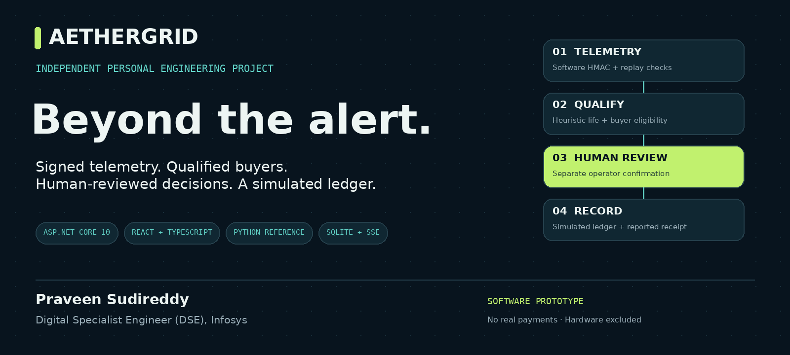
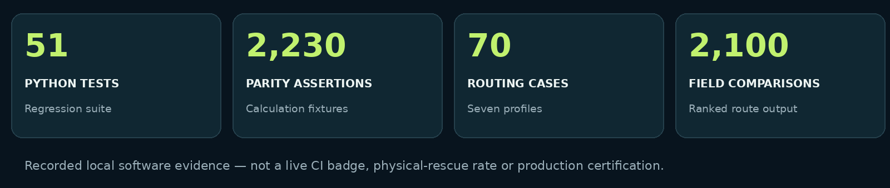
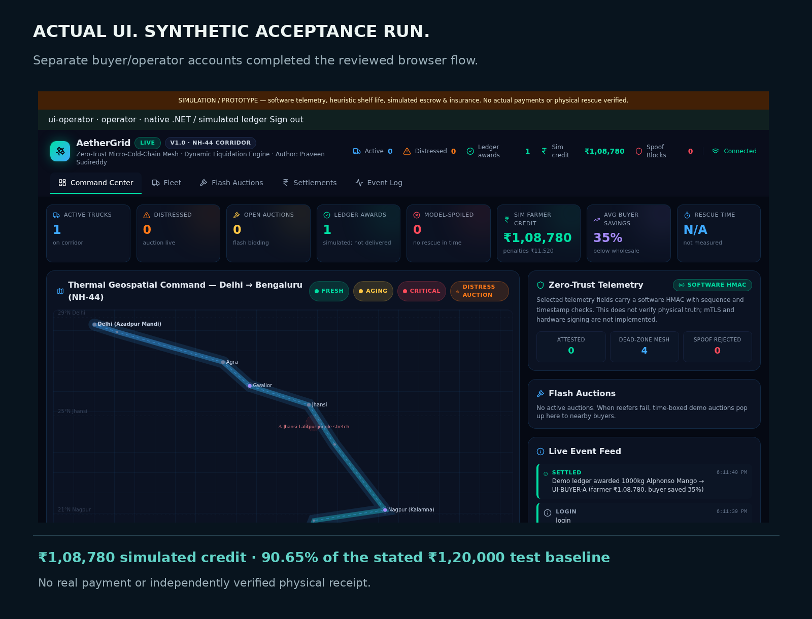
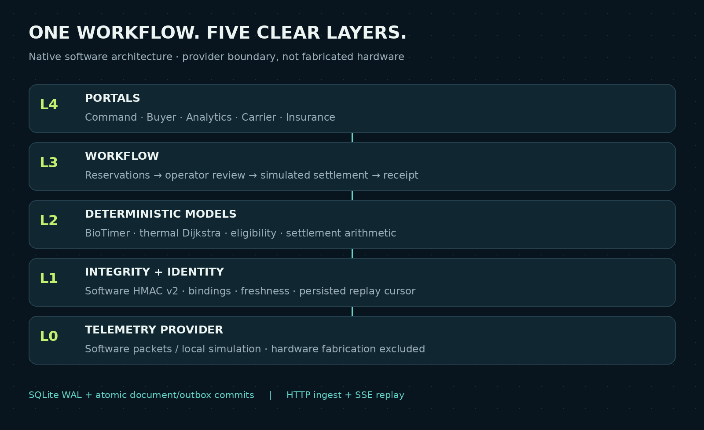

<div align="center">



**Cold-chain decisions beyond the alert.**  
Signed telemetry → eligible buyer → human review → simulated ledger.

[Explore the architecture](#3-architecture-and-layers) · [Run locally](#7-build-run-and-reproduce) · [Inspect the evidence](#2-current-status-and-fresh-end-to-end-checks) · [Contribute](#contributing-and-collaboration)

</div>

> **Project status:** tested software prototype, not a live cold-chain or financial service. Hardware fabrication is excluded. No real money, independently verified physical rescue or field-validated accuracy is claimed.



## Project tour

| Start here | What you will find |
|---|---|
| [Actual product view](#actual-product-view) | A screenshot from the two-role synthetic browser acceptance run—not a mockup or live deployment. |
| [Architecture](#3-architecture-and-layers) | Five layers, native/reference boundaries and the review workflow. |
| [Verification results](verification/final/acceptance-summary.json) | Machine-readable local acceptance results and explicit unverified outcomes. |
| [Presentation](paper/AetherGrid_Project_Praveen_Sudireddy.pptx) · [Slide PDF](paper/AetherGrid_Pitch_Deck_Praveen_Sudireddy.pdf) | Editable 17-slide project presentation. |
| [Technical report](paper/AetherGrid_Paper_Praveen_Sudireddy.pdf) | Seven-page project report; no peer-review claim. |
| [Build guide](#7-build-run-and-reproduce) | Fresh source build, private local configuration and disposable checks. |
| [Scope and next gates](#11-deployment-boundaries-and-remaining-work) | What is prepared, simulated or externally unverified. |

### Actual product view



<details>
<summary><strong>The engineering lesson behind this screen</strong></summary>

Operator-only smoke tests missed a buyer-role portal/API access mismatch. The final review fixed the data scope, then exercised separate buyer and operator browsers and checked that another buyer could not read the award or its financial totals. See [the recorded journey](verification/final/ui-journey.json).

</details>

---

# AetherGrid — Independent Personal Engineering Project

**Praveen Sudireddy | Digital Specialist Engineer (DSE), Infosys**  
**Master project summary, architecture, progress journal and operations guide**  
Consolidated review: **24 October 2026**.

AetherGrid is my independent personal project—not a startup, registered company or employer product. My professional role identifies the author only; no Infosys sponsorship, authorization or endorsement is claimed. There is no company office/headquarters/location claim. Bengaluru–Hyderabad below is a **proposed pilot corridor**, not a business location.

**Hardware fabrication is excluded.** All verified transaction outcomes are software simulations. No real bank/UPI/insurer transfer, independently verified physical rescue, field-calibrated biological accuracy or production certification is claimed.

This is the **single retained Markdown document**. It replaces earlier daily/release reports, claims audits, architecture/porting notes, hardware-scope notes and pilot Markdown guides. Source, required configuration, tests, selected historical evidence and final presentation/research artifacts are preserved. Cleanup decisions and deleted-file hashes are recorded in `verification/final/cleanup-manifest.json`.

## Contents

1. [Idea, purpose and uses](#1-idea-purpose-and-uses)
2. [Current status and fresh end-to-end checks](#2-current-status-and-fresh-end-to-end-checks)
3. [Architecture and layers](#3-architecture-and-layers)
4. [Models, policies and exact payout baseline](#4-models-policies-and-exact-payout-baseline)
5. [Workflow, persistence and API contracts](#5-workflow-persistence-and-api-contracts)
6. [Weekly-style work journal and historical results](#6-weekly-style-work-journal-and-historical-results)
7. [Build, run and reproduce](#7-build-run-and-reproduce)
8. [Security, recovery, rotation, retention and monitoring](#8-security-recovery-rotation-retention-and-monitoring)
9. [Provider interfaces and no-access lab](#9-provider-interfaces-and-no-access-lab)
10. [Calibration and supervised pilot procedure](#10-calibration-and-supervised-pilot-procedure)
11. [Deployment boundaries and remaining work](#11-deployment-boundaries-and-remaining-work)
12. [Workspace map, documents and cleanup policy](#12-workspace-map-documents-and-cleanup-policy)

## 1. Idea, purpose and uses

An alert that a refrigerated load is warming does not by itself identify an authorized decision-maker, a compatible buyer, an executable handover or a reconciled financial outcome. AetherGrid explores a **reviewed cold-chain intervention loop**:

> Telemetry → heuristic biological state → distress initiation → full-lot buyer eligibility → simulated reservation → manual operator decision → simulated ledger → operator-reported receipt.

The narrow proposed supervised pilot is mangoes on Bengaluru–Hyderabad with 5–10 trucks, existing telemetry/log exports and human approval. It has **not been conducted**. The wider legacy NH-44 Delhi–Bengaluru map is synthetic demonstration data, not a verified deployment, partner network or surveyed road/coverage map.

### Useful applications

- Personal engineering learning across React/TypeScript, Python/FastAPI, C#/.NET and transactional SQLite.
- Inspectable decision-support experiments and no-money rehearsal of distressed-lot workflows.
- Testing buyer compatibility, resource reservation races, duplicate rejection, timed release and consistent payout arithmetic.
- Comparing deterministic Python/.NET calculations and thermal-route outputs.
- Practising authorization, account lifecycle, recovery, monitoring and failure drills.
- Preparing a future supervised pilot without fabricating hardware or pretending synthetic data are real observations.

### Classification used throughout

| Category | Meaning |
|---|---|
| **Implemented/tested** | Executable software paths exercised by supplied checks. |
| **Simulated** | Generated readings, demand, balances, insurance calculations, credits and reviewer actions in tests. |
| **Prepared, not executed here** | Container recipes, container/image-scan CI and environment-specific deployment configuration. |
| **Externally unverified** | Physical quality/delivery benefit, real provider acceptance, actual transfers, independent security/operational approval. |
| **Excluded** | Hardware fabrication, secure-element construction and real BLE mesh implementation. |

## 2. Current status and fresh end-to-end checks

**Conclusion: the tested software flows run end to end. This does not mean every possible input, production deployment or external integration is verified.** Final acceptance results live in `verification/final/`.

### Fresh two-role browser journey

A new isolated native database and fresh published build were used. The test:

1. Created a synthetic carrier, truck, two buyers, buyer accounts and mango lot through authorized APIs.
2. Recorded an operator-reviewed synthetic initial-life baseline.
3. Submitted a Python-generated valid v2 HMAC packet; native service opened a distress auction.
4. Logged in as the actual **buyer role** in Chromium; the portal automatically selected its bound identity.
5. Reserved the full lot at ₹78/kg through the browser, with session/CSRF protection.
6. Checked that reservation alone produced **no settlement**.
7. Logged in as a **separate operator** browser and clicked the confirmation control.
8. Verified that the UI and persisted ledger showed **₹1,08,780 = 90.65%** of the ₹1,20,000 contract baseline.
9. Rejected repeat settlement; recorded a synthetic receipt through the API; verified duplicate receipt did not double-release capacity.
10. Proved another buyer could not read the award, its financial totals or private batch data.
11. Checked own-settlement visibility, CSV reporting and browser logout.

**Found and fixed during this review:** the native buyer portal fetched summary/settlement APIs that its role was not allowed to access. Earlier operator-only portal smoke tests had not exposed this. `PortalScope.cs`, native route authorization and the buyer identity binding now permit the required buyer views **without disclosing another buyer’s awards/totals**. The new role-specific browser acceptance test guards this regression.

Receipt entry in this test used the API; there is no claim that a receipt-entry UI or independent physical delivery was tested. Headless browser users are synthetic reviewers, not real operators or pilot participants.

### Executed evidence

| Check | Result / evidence |
|---|---|
| Fresh npm install, TypeScript/Vite build, locked native restore and Release publish | Passed; `build.log`. Bundle-size advisory remains. |
| Existing Python regression suite | **51 tests, 0 failures/errors/skips**; `test_results.json`. |
| Existing calculation parity | **2,230 assertions**; `calculation-parity.json`. |
| Native routing reference parity | **70 cases, seven profiles, 2,100 field assertions**; `native-v4.json`. |
| Native HTTP workflow / rejection checks | Passed; `http-integration.json`, `native-acceptance.log`. |
| Five authenticated operator portal routes | All HTTP 200; no page exceptions/unexpected failed API responses; `browser-smoke.json`. |
| Fresh actual buyer/operator browser journey | Passed; `ui-journey.json` and two journey screenshots. |
| SIGKILL with pending reservation | Fresh process recovered; deadline release happened once; `crash-rotation-retention.json`. |
| Root/API-key rotation, password recovery/change, expired auth cleanup, stale alerts, rate limit | Passed within native acceptance evidence. |
| Bounded local load | 80 requests at concurrency 12 all succeeded; timing recorded in `native-v4.json`; not a capacity SLA. |
| Python reference demo | Five portal routes/APIs, signed WebSocket accept/replay rejection and Socket.IO polling passed; `reference-services.json`. |
| Optional protected calculation API | Unauthorized blocked; authorized settlement matched fixture; `reference-services.json`. |
| Offline provider emulator / calibration QA | Passed; `offline-lab/report.json`. No real provider or biological validation. |
| Dependency scan snapshot | npm audit: 0 reported vulnerabilities; native NuGet query: no reported vulnerable packages; JSON retained. Not a full security audit. |
| PDFs / editable PPTX | Matching 17-slide PDF/PPTX; 7-page technical/research report; text, identity, bounds and LibreOffice PPT rendering checked. |

Earlier v3 recovery evidence separately includes online SQLite backup integrity and an independent application boot from the recovered backup. This review does not reclassify those older results as a new field/deployment test.

## 3. Architecture and layers



```text
             Five React / TypeScript portals (L4)
 Command | Buyer | Analytics | Carrier | Insurance
                    | same-origin HTTP
                    | session + CSRF / scoped bearer
                    v
       ASP.NET Core native workflow service (L3)
 baseline -> ingest -> distress -> reservation -> review
              -> simulated settlement -> reported receipt
                    |                           |
              SQLite transactions        Sandbox obligations
              documents + outbox         callback reconciliation
                    |
              SSE replay + polling -> portals
                    ^
    Deterministic models (L2): BioTimer, thermal Dijkstra,
                   eligibility, settlement
                    ^
    Software integrity (L1): HMAC v2, binding, timestamp,
               persistent sequence / checkpoints
                    ^
    TelemetryProvider boundary (L0): software packets,
                 local simulations / permitted imports
             HARDWARE FABRICATION EXCLUDED
```

| Layer | Responsibilities | Main source |
|---|---|---|
| L0 / telemetry boundary | Synthetic telemetry and independent log/import boundaries; no constructed device. | `backend/app/simulation/`, ingestion fixture scripts |
| L1 / integrity and identity | Software MAC, serial/truck/lot binding, freshness, increasing sequence, scoped account/key access. | Native `Security.cs`, `Workflow.cs`; Python `core/security.py`, `access.py` |
| L2 / models and decisions | Biological exposure, thermal route ranking, buyer gates, deterministic settlement. | `dotnet/AetherGrid.Core/`, native `Routing.cs`; Python `algorithms/`, `services/` |
| L3 / workflow and persistence | Atomic reservations, manual review, fallback, reported receipt, durable state/outbox, sandbox reconciliation. | Native `Workflow.cs`, `Store.cs`, `Providers.cs`, `Operations.cs`, `Reporting.cs` |
| L4 / presentation | Five React portals, native authentication gate, scoped buyer state, SSE/polling adapter. | `frontend/src/` |

### Technology and implementation boundaries

- **Primary software path:** ASP.NET Core 10 + React/TypeScript + SQLite WAL/FULL + HTTP telemetry + native SSE.
- **Reference/demo path:** FastAPI/SQLAlchemy + SQLite + WebSocket telemetry + Socket.IO. It remains useful for algorithm comparison and historical synthetic experiments.
- `AetherGrid.Core` contains portable BioTimer/eligibility/settlement engines. `AetherGrid.Parity` exercises frozen Python fixtures. `AetherGrid.Api` is an optional protected calculation-only API; `AetherGrid.Server` is the workflow server.
- Native SSE is **not** Socket.IO wire compatibility. Native and Python databases are distinct schemas; no automatic production-data migration is supplied.
- SQLite JSON documents and full scans suit a narrow supervised single-instance prototype, not demonstrated distributed scale.

## 4. Models, policies and exact payout baseline

### 4.1 BioTimer: heuristic, not trained ML

```text
thermal_factor = Q10 ^ ((temperature_C - 5) / 10)
rate = thermal_factor * humidity_factor * ethylene_factor
life_increment = rate * exposure_hours / shelf_reference_hours
if door_open: life_increment *= 5
life_consumed = min(1.5, previous_life + life_increment)
```

The implementation-defined humidity/ethylene factors and door multiplier are assumptions. Mango defaults: reference life **264 h**, Q10 **2.8**, optimal temperature **12°C**. There are seven configured commodity profiles. No fitted ML network, field accuracy bound, microbial prediction or safe-to-eat certification is claimed.

Health thresholds are fresh below 0.35 consumed fraction, aging below 0.65, critical below 0.95, otherwise spoiled. Optimistic RVH at optimal conditions differs from spoilage ETA under current temperature. The distress heuristic compares RVH with three times estimated destination travel time alongside adverse temperature/health conditions. Optimistic life and simplified ETA can overstate feasibility.

The native receiver integrates signed elapsed timestamps from a reviewed initial baseline/checkpoint. It enforces freshness and an exposure-gap stop instead of silently inventing missing exposure. Python demo/replay can explicitly accelerate biological time; historical one-hour-per-packet experiments were simulations, not real elapsed exposure.

### 4.2 Thermal routing

Native ranked reference planning implements Python’s bidirectional thermal Dijkstra weights: edge travel time, temperature/reefer projection, coverage, road category, accident risk and life urgency. It ranks original delivery, nearby buyer liquidation and cold-storage alternatives. Reference output parity is checked on 70 deterministic cases, not proven for every input.

`GET /api/batches/{id}/route-options` applies additional candidate checks (preauthorization, commodity, capacity, radius and model reachability). Price-dependent financial eligibility is rechecked at bid. Operator-reviewed model selection requires current eligibility, a meaningful evidence note and acknowledgement. `AETHER_AUTO_MODEL_ROUTING=true` optionally changes the **model target** on accepted telemetry; default is manual model-target selection.

Neither mode dispatches a truck, replaces dispatcher consent, changes the original contractual destination or resets consumed life. Cold holding may slow deterioration; it cannot rejuvenate cargo. The fixed graph and straight-line ETA approximations are not validated navigation or verified hub availability.

### 4.3 Buyer eligibility

Require known policy, preauthorization, accepted commodity, exactly the complete lot, sufficient remaining capacity, adequate simulated funds at the offered price, buyer/rescue radius, unexpired auction and reachability within remaining model life. The bid gate uses distance / 30 km/h plus 15 minutes handling, not a validated traffic service. First accepted bid is not unconditionally eligible or settled.

### 4.4 Settlement and baseline

| Item | Synthetic default example |
|---|---:|
| Lot | 1,000 kg mangoes |
| Contract / wholesale baseline | ₹120/kg; **₹1,20,000** |
| Rescue bid / salvage | ₹78/kg; **₹78,000** |
| Sum assured | 60% of contract = ₹72,000 |
| Cover cap | 45% × ₹72,000 = ₹32,400 |
| Calculated insurance after 5% deductible | **₹30,780** |
| Farmer simulated credit | **₹1,08,780** |
| Recovery / buyer discount | **90.65% / 35%** |

Insurance = min(shortfall, cover × sum assured) × (1−deductible). Farmer credit includes salvage, calculated insurance and a top-up bounded by available modeled penalty. A target floor is not a funded universal guarantee. General engine inputs use floating point for reference parity; financial sandbox obligations use integer paise.

Old unqualified 95–99%/98.3% recovery headlines, guaranteed floors, solved physical tampering, instant real settlement, universal three-minute rescue and unverified market/loss statistics are **superseded and must not be reused**. Fast automated initiation is not zero-human-approval final settlement or verified rescue.

## 5. Workflow, persistence and API contracts

### State and transaction discipline

- Lot baseline cannot reset already-ingested history.
- Accepted telemetry atomically persists exposure/checkpoint, truck sequence cursor, lot state, sample and outbox event.
- Eligible bid atomically reserves full-lot buyer capacity and simulated funds, entering `AwaitingConfirmation`.
- Operator confirmation explicitly acknowledges simulation, creates one settlement and retains an evidence snapshot/hash.
- Rejection, timeout or unavailable lot releases once; bounded child auctions (maximum two retries) do not silently expand scope. Exhaustion creates a manual-intervention event.
- A full-lot receipt with a unique reference is an **operator assertion**; repeat identical receipt is idempotent. Conflicting/partial receipts require manual dispute review. Capacity releases once; there is no independently verified delivery endpoint.
- Transactional outbox events are replayable by sequence through native SSE. A database hash/outbox is not independent tamper-proof legal evidence.

### Main API groups

| Purpose | Native routes |
|---|---|
| Authentication | `POST /api/auth/login`, `GET /api/auth/session`, `POST /api/auth/logout` |
| Account maintenance | `POST /api/auth/change-password`, `POST /api/auth/recover`, operator recovery/revoke-user routes |
| Provisioning | `POST /api/admin/provision`: `{kind, record}` |
| Baseline / telemetry | `POST /api/batches/{id}/baseline`, `POST /api/telemetry` |
| Bid / review | `POST /api/auctions/{id}/bid`, `POST /api/auctions/{id}/confirm` |
| Receipt | `POST /api/batches/{id}/delivery` |
| Routing | `POST /api/routing/evaluate`, `GET /api/batches/{id}/route-options`, `POST /api/batches/{id}/route-decision` |
| Portal views | batches, buyers, auctions, settlements, summary, events, route, commodities, carrier SLA, insurance simulation records |
| Reporting / events | `GET /api/settlements/export.csv`, operator `GET /api/stream` |
| Operational checks | admin integrity/readiness, retention preview/apply, API-key rotate/revoke |
| Sandbox obligations | `/api/integrations/intents`, dispatch and callback routes |

Provision in dependency order: carrier → truck; buyer; batch; bound accounts/API keys. Device keys need explicit truck binding; buyer users/keys need explicit buyer binding. API-key IDs are SHA-256 digests of opaque bearer tokens, never raw tokens. User records contain validated PBKDF2 hashes, not plaintext passwords.

Baseline fields: `reference_timestamp`, `initial_life_consumed`, `hours_out_of_range`, unique `reference`, meaningful `evidence_note`. Native telemetry uses v2 software MAC and real integer epoch timestamp, ±120 s freshness, increasing per-truck integer sequence and exposure gap no greater than 120 s. Excessive gaps require review. See executable fixture construction in `scripts/verify_native_server.py` and `scripts/verify_ui_journey.py`.

Native browser writes use session + `X-CSRF-Token`; `/api/auth/session` supplies it. Manual confirm body uses `action: confirm|reject` and `simulated_escrow_acknowledged: true`. Legacy Python operator-token headers are not needed for a logged-in native operator.

## 6. Weekly-style work journal and historical results

**Dates/hours for individual calendar weeks were not supplied. The following are retrospective work-package groups suitable for a weekly report—not a claim that four or five actual calendar weeks elapsed.** Available project logs identify Day 1–4 and software v2/v3/v4 work; recorded evidence dates centre on 23–24 October 2026. No attendance, time spent or employer assignment is invented.

| Weekly-report group | Work completed / what I built | Evidence / qualification |
|---|---|---|
| Foundation: initial demo | Set up Python/SQLite backend, simulated trucks, React five-portal UI and map; fixed cold-start asset and Socket.IO routing issues. | Day 1 artifacts/historical smoke JSON; early auto-award narrative later superseded by reviewed workflow. |
| Correctness and claims review | Audited deck/paper claims; fixed stated payout baseline; added full-lot buyer gates, manual confirmation, fallback and explicit simulation labels; distinguished financial awards from physical rescue. | Historical Day 2–4 results and seeded studies; unsupported claims removed, not silently preserved. |
| Repeatable verification | Added automated unit/concurrency/replay checks, browser/HTTP smoke, seeded independent/fleet experiments, PDF QA and historical walkthrough recording. | Historical v1 had 22 tests and a recorded 181 s software cycle; not current production validation. |
| Software v2 hardening | Added scoped digest access, durable exposure/checkpoint/cursor recovery, software MAC v2, reviewed baselines, delivery-report release, sandbox intents, calibration candidate fitter, pilot procedures and backup tooling. Ported BioTimer/eligibility/settlement to C# with parity fixtures. | 51 Python tests; 2,230 calculation assertions. Hardware excluded. |
| Native software v3 | Built standalone ASP.NET workflow/storage server, browser authentication/CSRF/RBAC, durable SSE replay, portal/reporting contracts, manual ledger flow, sandbox reconciliation and restart/backup checks. | Native HTTP + five-portal operator smoke; whole-server/field equivalence not asserted. |
| Software v4 operations | Added ranked buyer/cold route parity, optional model rerouting, password recovery/change, API/signing-key rotation, safe retention, readiness alerts, forced-kill recovery, load/dependency checks, container recipes/CI and local no-access laboratory. | 70 routing cases / 2,100 fields; local emulator and seven synthetic calibration pipelines. Container build not executed. |
| Current final acceptance / consolidation | Fresh builds; real buyer/operator browser journey; fixed buyer-role portal/API mismatch and isolation; rechecked Python/reference/calculation services; updated personal-project identity in editable PPTX and PDFs; consolidated documentation and audited cleanup. | `verification/final/`; delete manifest distinguishes retained evidence from removed generated files. |

### Historical experiments — do not relabel as new or field results

- Independent eligibility study: **1,000** synthetic scenarios; **440 (44%)** eligible reservations.
- Five-truck software replay: **1,000 runs / 5,000 lots**; **460 distressed lots**, **371 auctioned**, **168 ledger awards**. Awards / distressed lots = **36.521739%**.
- Awarded-only mean recovery **92.0473%**. It excludes failed lots and is not all-farmer benefit.
- These distributions differ from the single default-policy acceptance example (90.65%). They are not causal comparisons or physical rescue rates.
- Historical original study hashes: fleet JSON `036a2ed0ce96c0aeeb5a38b6a32e3e22ab8691f73af0ca50de46a36d6ac2aa55`; fleet CSV `d624ec05de1be011e127d96c1c5df1874348f394f8db6cb2883471e0c10358b1`.
- Historical media, selected result JSON/CSV and manifests are retained as history. Old source ZIPs and redundant renders are removed; historical manifests may refer to artifacts intentionally removed in the cleanup ledger.

## 7. Build, run and reproduce

### Prerequisites

.NET SDK **10**, Node **22 recommended** (fresh checks also ran under Node 20.20.2), npm and Python 3.12+ for reference/tests/tools. Use a top-level browser when Strict cookies are blocked inside a cross-site embedded preview.

From project root:

```bash
# Optional official SDK installer if dotnet is not already installed:
bash scripts/dotnet-install.sh --channel 10.0 --install-dir "$HOME/.cache/dotnet" --no-path
export DOTNET="$HOME/.cache/dotnet/dotnet"   # or: export DOTNET=dotnet
bash scripts/build_software.sh
```

The helper performs locked native restore, `npm ci`, frontend build and native Release publish to `.runtime`, embedding assets in `.runtime/wwwroot`. It rebuilds generated output deliberately removed during final cleanup. **Use a separate restore step; `dotnet publish --locked-mode` is invalid.**

### Configure your own local users and secrets

```bash
mkdir -m 700 private
python scripts/create_native_user.py private/users.json --username your-operator
export AETHER_USERS_FILE="$PWD/private/users.json"
export AETHER_DB="$PWD/private/native.db"
export AETHER_TELEMETRY_ROOT="$(python -c 'import secrets;print(secrets.token_hex(32))')"
export AETHER_CALLBACK_SECRET="$(python -c 'import secrets;print(secrets.token_hex(32))')"
(cd .runtime && "$DOTNET" AetherGrid.Server.dll --urls http://0.0.0.0:8010)
```

If `DOTNET=dotnet`, the command resolves through PATH. Do not put production passwords/tokens in source or chat. The service begins empty except bootstrap users; provision synthetic records via the API as in the executable acceptance fixture. Bootstrap creates missing users only; it does not overwrite security state. The local HTTP example leaves `AETHER_PRODUCTION` unset. Real TLS deployment **must** set `AETHER_PRODUCTION=true` for Secure cookies and restrict direct HTTP exposure.

There are no operational credentials, prefilled real data or running servers left by cleanup. Automated fixtures contain clearly labeled test-only values and create private disposable DBs at runtime.

### Reproduce checks

```bash
pip install -r backend/requirements.txt -r scripts/requirements.txt
python -m playwright install --with-deps chromium
# First execute build_software.sh above.
AETHER_EVIDENCE_DIR=verification/final \
AETHER_TEST_PRIVATE=.acceptance-private/native \
AETHER_SERVER_DLL=.runtime/AetherGrid.Server.dll \
python scripts/run_v4_checks.py

python scripts/verify_ui_journey.py
python scripts/verify_reference_services.py
python scripts/run_tests.py
"$DOTNET" run --project dotnet/AetherGrid.Parity -- verification/v2/parity_fixtures.json
AETHER_EVIDENCE_DIR=verification/final python scripts/offline_readiness_v4.py
python paper/build_deliverables.py
python scripts/check_deliverables.py
```

Export `DOTNET` so child Python processes can find the runtime. Native adverse tests use port 8020, UI journey 8030, Python reference 8040 and optional calculation API 8041. Scripts start finite child processes and stop them; never point them at an operational database. Reference Socket.IO long-poll shutdown can take approximately one heartbeat interval to drain. Test DBs live only in declared private disposable directories.

The primary HTTP test helper and browser smoke scripts can be reused independently with `AETHER_TEST_URL` and `AETHER_EVIDENCE_DIR`. The native rank/parity script expects synthetic fixtures from its parent harness, not a live unseeded service.

### Reference Python demonstration

```bash
export AG_OPERATOR_TOKEN='your-local-demo-review-token'
bash scripts/run_demo.sh
```

This is an explicitly **demo-mode** path with seed data and optional accelerated simulation timing, not the native production-authentication path. Do not expose it as a live operational service. For native acceptance use the published .NET workflow and its account/key controls.

## 8. Security, recovery, rotation, retention and monitoring

### Identity, recovery and password maintenance

- Passwords are PBKDF2-SHA256 hashes; sessions are opaque, HttpOnly, Strict, expiring and tied to account version.
- Production flag sets Secure cookies; production TLS/proxy config and independent security review remain required. Rate limits use connected peer; a reverse proxy can aggregate clients unless deliberately configured.
- `POST /api/admin/password-recovery/{username}` returns a one-time token once; only a trusted operator may issue/deliver it. Verify recipient identity through a separate approved channel; never put token in URL/logs.
- Public rate-limited `POST /api/auth/recover` body `{token,password}` consumes a valid 20-minute token and invalidates old browser sessions. It does not enable a disabled user.
- `POST /api/auth/change-password` body `{old_password,new_password}` requires authenticated browser account/CSRF and the current password; sign in again afterward.
- Local break-glass utility: stop service, back up DB, then `python scripts/recover_native_account.py DB --username USER --service-stopped`. It does not silently grant roles or enable disabled accounts. Interactive operational use is supplied/syntax-checked, not part of the automated acceptance evidence.

### API and software signing-key rotation

- `POST /api/admin/api-keys/{old_digest}/rotate`: `{new_digest,expires_at}`. New opaque token is generated privately by the client; only its SHA256 digest is submitted. Expiry must be future and within 90 days. Old key is disabled atomically; binding/role retained.
- `POST /api/admin/api-keys/{digest}/revoke` immediately revokes a key.
- Optional `AETHER_SIGNING_KEYS_FILE` is a private serial-keyring file. When configured, missing serial means **no authorization**; there is no global root fallback. Startup still requires a strong bootstrap `AETHER_TELEMETRY_ROOT`.
- Keyring shape: `{ "SOFTWARE-SERIAL": [{"root":"a private random 32+ character root","not_after":1893456000}] }`. The software v2 signer derives MAC key from `root|serial`. This is not hardware identity.

```bash
python scripts/update_signing_keyring.py private/keyring.json \
  --serial SOFTWARE-SERIAL --overlap-seconds 300
```

Default overlap 0; maximum one hour; lifetime 1–90 days. The utility atomically replaces the private file without printing roots. Coordinate secure delivery to authorized **software** signers, monitor expiry and avoid concurrent writers. For containers mount the parent directory read-only: atomically replacing a single-file bind mount can leave the container reading the old inode. Compose uses a private secrets-directory mount.

### Retention and alerts

`GET /api/admin/retention/preview`; `POST /api/admin/retention/apply` with `{acknowledged:true}`. Removes expired session/recovery records and sufficiently old timestamped login attempts only. Unknown-age legacy records are retained conservatively. It preserves telemetry, ledger, outbox, evidence, obligations, callbacks and replay watermarks. A real long-term data-protection/financial retention policy must be reviewed separately; nothing silently deletes that history.

`GET /api/admin/readiness` reports stale/missing telemetry, overdue reconciliation and SQLite integrity. Scheduler-friendly check:

```bash
python scripts/watch_readiness.py --url https://YOUR-HOST \
  --token-file /private/operator-token
```

Exit 0 healthy, 1 alerts, 2 monitor/request failure. Connect the output to an approved alert system; no external email/webhook alert was delivered in acceptance. Full integrity/document scans must be benchmarked before scaling.

### Backup and recovery

```bash
python scripts/backup_sqlite.py private/native.db private/new-backup.db
```

Uses SQLite online backup, verifies integrity and refuses overwriting an existing destination. Do not merely copy a live DB without its WAL. Keep source/backup private and encrypt offsite backups externally. Restore to a new file while the target service is stopped, validate integrity, configure DB path/secrets, compare obligations and **reconcile device sequence/watermarks before reopening ingestion**. Old backup restore can admit post-backup replay unless quarantined/reconciled. This is a single-instance prototype, not verified high availability.

Software MAC/checkpoint security does not prove sensor placement, source truth, owner consent, legal non-repudiation or resistance to host/DB compromise. Some historical field names include HSM/mTLS wording; no physical implementation follows from those names.

## 9. Provider interfaces and no-access lab

### Native sandbox obligation contract

- Create `POST /api/integrations/intents` with `batch_id`, `kind` (`payment|insurance`), unique `idempotency_key` (12–120 chars), simulation acknowledgement. Amount derives from confirmed settlement, not arbitrary caller money.
- Dispatch `POST /api/integrations/intents/{id}/dispatch` with acknowledgement: state becomes pending with deterministic `SANDBOX-…` reference; **no network call or custody of funds**.
- Operator-authenticated callback `POST /api/integrations/intents/{id}/callback`: `event_id`, `provider_reference`, `state` (`succeeded|failed`), integer `amount_paise`, `currency=INR`, integer epoch `timestamp` within ±300 s; cookie writes also need CSRF.
- `X-Callback-Signature` is lowercase hex HMAC-SHA256 using `AETHER_CALLBACK_SECRET` over UTF-8 `id|event_id|provider_reference|state|amount_paise|currency|timestamp`.
- Exact event duplicate is idempotent; ID collision, wrong amount/currency/reference, stale event and terminal reversal are rejected. Poll intents to inspect reconciliation. “Succeeded” is sandbox state only, not actual payment.

This is **our own envelope**, not Razorpay/UPI/any insurer’s signing contract. No named-provider compatibility or legal escrow is asserted. Orders/payment collection, payouts and custody/escrow are distinct products.

### What can be done without access—and has been run

`offline_readiness_v4.py` starts a local HTTP emulator, tests stable idempotency and changed-amount conflicts, creates ambiguous 502/read-timeout responses **after commit**, then reconciles by lookup instead of blindly retrying a financial POST. It also runs seven explicitly synthetic calibration pipelines, enforcing opt-in and lot separation. No credentials or bank account are needed for those tests.

To validate a real adapter later: select the actual product/provider, review published API/idempotency/callback/lookup semantics, establish legal/KYC eligibility, obtain permitted developer/test access, register a callback and securely manage credentials. Do not invent acceptance while that access is absent. Live money additionally requires explicit legal/operational authorization.

## 10. Calibration and supervised pilot procedure

### Data needed

Use existing telemetry/loggers or operator exports, not newly fabricated hardware. Keep pseudonymous lot/truck IDs, source reference, timezone/timestamps, raw readings/gaps, loading/door/handling history, cultivar/maturity, packing, initial condition, assessor/method and quality endpoint. Record permissions and missingness; do not fabricate observations or call generated examples “field”.

- `pilot/calibration_template.csv`: intentionally empty controlled-temperature fitter input.
- `pilot/PILOT_CAPTURE_V4.csv`: richer blank collection/provenance template.
- Candidate fitter: `backend/app/calibration/fit_q10.py`; controlled constant-temperature observations only, fixed 5°C reference. Not suitable by itself for varying-temperature truck logs or food safety.
- At least three distinct training temperatures; independent train/holdout lot IDs; adequate held-out observations; finite positive measurements.
- Fitter provenance labels are user assertions, not independently verified source evidence. Low synthetic error means pipeline consistency, not accuracy.
- Candidate coefficients never auto-replace production parameters. Review by cultivar/season, uncertainty, confounders and qualified quality/food-safety experts.

### Before enrolling a real lot

Obtain owner/farmer/carrier/receiver/dispatcher consent and written redirection authority; agree liability, quality criteria, cold compatibility, availability, actual road ETA and dispute/withdrawal procedure. Keep v1 no-money and human-reviewed. Stop on unreliable readings, unsafe/uncertain quality or unauthorized handover; software must not instruct physical diversion without human authority.

### Supervised sequence

1. Operator validates source, gaps, initial baseline, quality assessment and road ETA.
2. Buyer independently confirms full-lot commodity/quality/temperature/capacity/handling availability.
3. Owner/dispatcher authorizes the proposed handover. Software bid reserves simulated resources only.
4. Operator approves/rejects with personal credentials and simulation acknowledgement.
5. Record pickup, travel, weighbridge/quality receipt, receiver acknowledgment and discrepancies.
6. Only a matching complete receipt permits one-time capacity release; partial/damaged receipts require dispute review, not editing into success.
7. Independent reviewer reconciles documents and raw evidence. Only then may a pilot outcome be classified as physically verified.

Publish denominators covering all enrolled, failed, withdrawn, no-buyer and expired lots. Separate physical delivery, usable-quality recovery, financial recovery and simulated award. Do not report awarded-only mean recovery as all-farmer benefit.

## 11. Deployment boundaries and remaining work

Dockerfile/Compose provide non-root process, read-only filesystem, private data/secrets mounts, dropped capabilities, bounded tmpfs/PIDs/memory and loopback HTTP binding. They are **prepared, not container-tested here**: this sandbox has no Docker/Podman runtime/daemon and no effective Linux capabilities. GitHub Actions includes native tests, Docker build and Trivy gate, but no CI run or image scan result is claimed.

On a capable host, use `docker compose -f deployment/compose.yml build` and supply secrets externally. Compose expects `private/secrets/users.json`, `private/secrets/keyring.json` and writable `private/data/`; check image user UID/permissions. Terminate TLS, preserve public host/origin and restrict direct HTTP access. Review/pin images/actions for your organization; tags are not supply-chain attestations.

Remaining external gates:

- Container build/image scan execution; actual deployment/TLS/proxy/alert checks.
- External penetration/security review, MFA/SSO decision, operating ownership, offsite recovery and load/capacity sign-off.
- Actual selected-provider adapter validation with permitted access and contractual reconciliation semantics.
- Genuine biological calibration, quality review, consented supervised pilot and independently verified outcomes.

Passing local tests does not replace those gates. Hardware fabrication is **not** on the remaining-work list.

## 12. Workspace map, documents and cleanup policy

```text
aethergrid/
  README.md                       single master Markdown
  backend/                        Python reference/demo source and 51-test suite
  frontend/                       editable React/TypeScript source + package lock
  dotnet/                         native workflow/Core/parity/optional API source
  deployment/ + .github/           container and CI recipes
  pilot/                          blank CSV data templates
  paper/
    build_deliverables.py          common text -> PDF deck + editable PPTX + report
    AetherGrid_Project_Praveen_Sudireddy.pptx
    AetherGrid_Pitch_Deck_Praveen_Sudireddy.pdf
    AetherGrid_Paper_Praveen_Sudireddy.pdf
  scripts/                        build, tests, operations and document QA
  verification/final/             current acceptance, role-specific UI and cleanup evidence
  verification/v2,v3,v4/          selected historical result evidence / parity fixtures
```

Final presentation identity: **“AetherGrid — An Independent Project by Praveen Sudireddy | Digital Specialist Engineer (DSE), Infosys”**, with author-only affiliation/no endorsement. The editable PPTX was newly created because the pre-review workspace contained only a PDF slide deck, not an editable PowerPoint. Project-oriented uses replace commercial-pitch content; unsupported location/founding/traction claims are not retained. The technical report is seven pages; slide deck is seventeen slides.

Cleanup is inspected and recorded before deletion. Preserve source, manifests/lockfiles, test fixtures, current PDF/PPTX, meaningful historical JSON/CSV/recording and current QA. Remove obsolete release ZIPs, build output, cache/dependency directories, stale synthetic DBs/WAL/private test credentials, redundant renders and replaced Markdown/builder assets. Keep one current cleaned source package rather than multiple outdated archives. Required generated assets and private runtime state are rebuilt on demand using the commands above.

**Do not delete operational data using this cleanup policy.** This workspace contains local demo/test fixtures only; the cleanup manifest enumerates the actual inspected candidates and reasons. External SDK/tooling installations are not project source and are not part of the source package.

### Final cleanup outcome

Reviewed and removed **10,879 generated/obsolete files (~276.4 MiB)** across 89 audited candidates, plus known root install scratch logs. Only **README.md** remains as project Markdown. Useful source, locks/configs, tests, current PDFs/editable PPTX, selected historical evidence and final acceptance results are retained. Post-cleanup static integrity checked required files, 64 Python source parses, document identity/counts and absence of leftover test databases. Runtime/dependency outputs were deliberately removed **after** successful execution; rebuild with `scripts/build_software.sh`. One current cleaned ZIP replaces four outdated source archives.


## Contributing and collaboration

Thoughtful, evidence-driven contributions are welcome. Start with a minimal **synthetic** reproduction or a narrowly scoped improvement proposal. Good areas to explore include role-specific browser regressions, exposure-gap handling, deployment checks on a capable container host, accessibility and documentation clarity.

1. Read the project boundaries and relevant reproduction instructions above.
2. Open a bug/improvement issue using the repository form; agree scope before a substantial change.
3. Add a regression check, list the exact commands/results and disclose checks you could not run.
4. Keep financial simulation, heuristic quality and externally verified outcomes clearly separate.
5. Never submit real customer data, account credentials, private keyrings or a private database.

Please preserve the single-master-Markdown convention: add documentation here instead of proliferating separate Markdown files. Deployment/field claims must be supported by actual evidence, not generated data. Hardware fabrication is outside this project scope.

## Security policy and responsible reporting

Do not put credentials or a potentially sensitive vulnerability in a public issue. If this repository has GitHub private vulnerability reporting enabled, use **Security → Report a vulnerability**. Otherwise contact the repository owner through an existing trusted private channel; do not post exploit details publicly while looking for one. Private reporting is a setting that must be enabled by the owner; it is not claimed to be active here.

The retained tests use clearly synthetic fixture secrets. They are not deployment credentials. Public visibility and automated scans do not establish production security. Rotate any accidentally exposed real credential immediately and remove it from history using a reviewed procedure—not just a later file edit.

## License and attribution

Licensed under the **Apache License 2.0**. See [LICENSE](LICENSE) for the complete terms and [NOTICE](NOTICE) for attribution. The license includes conditions, patent provisions and warranty/liability disclaimers; review the actual terms before use. Third-party dependencies retain their own licenses. Author affiliation is professional context only, not an employer product or endorsement.

If the project helped you understand reviewed software workflows, a star is appreciated. More useful still: a reproducible bug report, a thoughtful test case or a constructive technical review. No adoption, performance or star-count guarantee is made.
